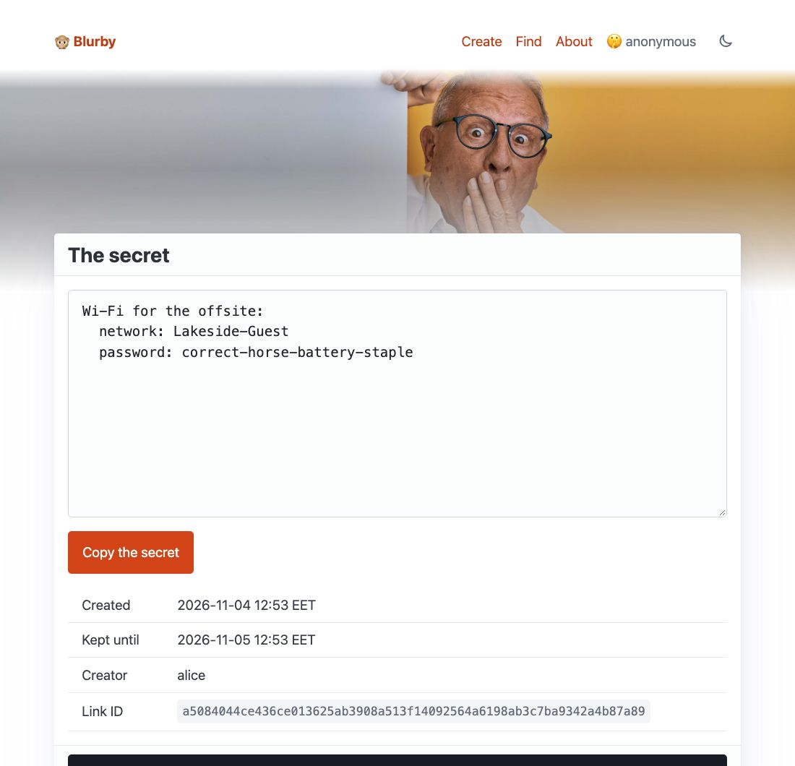

# Blurby

Simple little Flask app that takes pastebin-like of data from user and stores it in a sqlite file.

## How-To

Install the dependencies with [uv](https://docs.astral.sh/uv/) (`uv sync`), then just run `uv run blurby --debug` and head out to your browser with the url [http://127.0.0.1:5000](http://127.0.0.1:5000).

Check the Using Docker section for more info.

### Parameters

Configuration is done via environment variables. The following are the available parameters:

    - `BLURBY_DB_FILE`: Path to the sqlite database. (defaults to `/blurby/data/sqlite.db`)
    - `BLURBY_HOST_IP`: Host to bind the server to. (defaults to `0.0.0.0`)
    - `BLURBY_TTL_HOURS`: How long to keep a paste in the database. (defaults to `48`)
    - `BLURBY_THREADS`: Number of threads to use for processing. (defaults to `8`)
    - `BLURBY_CLEANUP_INTERVAL`: Seconds between passes that delete expired pastes. (defaults to `60`)

`uv run blurby` serves the app with waitress on port `8080`. When run from the command line, the following *additional* parameters are available:

    - `--debug`: Run the Flask debug server on port `5000` instead. (On macOS, the AirPlay Receiver may already be using port 5000.)

### Initializing database

The application now checks if a `BLURBY_DB_FILE` environment variable is set. If it is, it uses that as a DB file. If the file is missing but the path is valid it creates the db file.

Manually: To create a blank Sqlite DB for the app use the `uv run python -m blurby.setup_database` command.

## Using docker

To use docker simply run the container with prefered volume maps. The container serves on port `8080` and keeps the SQLite database in `/blurby/data`.

ex. 
`docker container run -p 8080:8080 -v /your/path/data:/blurby/data joniturunen/blurby`

The database file is created on first start if it's missing (see [Initializing database](#initializing-database)). The mounted folder must be writable by the container's `appuser` (UID 5678). Logs go to the container's stdout (`docker logs`).

## Todo

- Possibility to create logfile entries
- Better error handling
- Add view history to entries

## Credits

Photo by <a href="https://unsplash.com/@krakenimages?utm_source=unsplash&utm_medium=referral&utm_content=creditCopyText">krakenimages</a> on <a href="https://unsplash.com/s/photos/secret?utm_source=unsplash&utm_medium=referral&utm_content=creditCopyText">Unsplash</a>

Icons: 
- [Font Awesome](http://fontawesome.io)

Other:
- [jQuery](http://jquery.com)
- [Scrollex](https://github.com/ajlkn/jquery.scrollex)
- [Responsive Tools](https://github.com/ajlkn/responsive-tools)

Theme:
Massively by HTML5 UP
html5up.net | @ajlkn
Free for personal and commercial use under the [CCA 3.0 license](https://html5up.net/license)

## Screenshot

